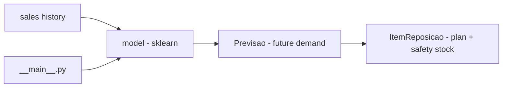

# previsao-demanda-estoque

**English** · [Português (Brasil)](README.md)

[](#) [](#) [](#) [](#) [](LICENSE)

## What it is

**Demand forecasting and inventory replenishment**: it generates synthetic sales history (or uses a product's past), trains a model (scikit-learn) to **predict future demand** and produces a **replenishment plan** with **safety stock**, in a **deterministic** way (same parameters → same result). It is an educational ML lab applied to supply chain/inventory.

## Status

An educational ML/operations lab, working and tested (6 tests).

## Features

- **Demand forecast model** (`Previsao`): predicted demand for a future date.
- **Replenishment plan** (`ItemReposicao`): projected stock, safety stock, forecast demand.
- **MAE evaluation** (`mean_absolute_error`).
- **Determinism**: fixed seed (`--random-state 42`).
- **CLI**: `--dias-historico` (365), `--dias-futuro` (30), `--estoque-atual` (100), `--estoque-seguranca` (20), `--produto` (SKU-001).

## Architecture

A `previsao_demanda_estoque` package (at the root, no `src/`) with `modelo.py` (logic) and `__main__.py` (CLI). History → model → forecast → replenishment plan.



## Stack

- Python ≥ 3.10
- scikit-learn ≥ 1.3, numpy ≥ 1.24
- pytest (dev)

## Repository layout

```
previsao-demanda-estoque/
├── pyproject.toml · BRIEF.md
├── previsao_demanda_estoque/
│   ├── modelo.py      # forecast + replenishment plan
│   └── __main__.py    # CLI
├── tests/test_modelo.py
└── LICENSE            # MIT
```

## Prerequisites and installation

Python ≥ 3.10.

```bash
pip install -e .
```

## How to run

```bash
python -m previsao_demanda_estoque --dias-historico 365 --dias-futuro 30 --estoque-atual 100
# predicts future demand and generates the replenishment plan for SKU-001
```

## Tests and quality

Real command (verified by the agent):

```bash
python -m pytest tests/
# 6 passed
```

## Technical decisions and trade-offs

- **Determinism with a fixed seed**: reproducible and comparable results.
- **Synthetic history**: lets you test the pipeline without real data; in exchange, it does not reflect a real sales series.
- **Forecasts demand and replenishment together**: links the prediction to the operational effect (how much to reorder).

## Known limitations and roadmap

- Model trained on synthetic data — validate/retrain with real history before use.
- No advanced seasonality/trend beyond what the model captures.
- No dashboard/visualization.

## Development process

An individual project by Kelvin Oliveira, built with orchestrated AI agents and reviewed by the author. The demand modeling and the review are the author's.

## License and author

MIT — Copyright (c) 2026 Kelvin Rebelo de Oliveira.

**Author**: [Kelvin Oliveira](https://github.com/KelvinOliveiraCode) · [Portfolio](https://kelvinoliveiracode.github.io/portfolio/)
