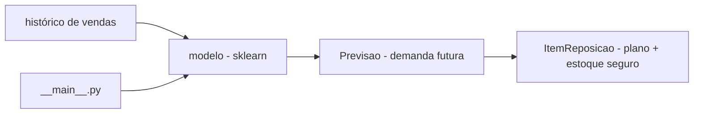

# previsao-demanda-estoque

[English](README.en.md) · **Português (Brasil)**

[](#) [](#) [](#) [](#) [](LICENSE)

## O que é

**Previsão de demanda e plano de reposição de estoque**: gera histórico de vendas sintético (ou usa o passado do produto), treina um modelo (scikit-learn) para **prever a demanda futura** e gera um **plano de reposição** com **estoque de segurança**, de forma **determinística** (mesmos parâmetros → mesmo resultado). É um laboratório educacional de ML aplicado a supply chain/inventário.

## Status

Laboratório educacional de ML/operações, funcional e testado (6 testes).

## Funcionalidades

- **Modelo de previsão de demanda** (`Previsao`): demanda prevista para data futura.
- **Plano de reposição** (`ItemReposicao`): estoque projetado, estoque de segurança, demanda prevista.
- **Avaliação com MAE** (`mean_absolute_error`).
- **Determinismo**: seed fixa (`--random-state 42`).
- **CLI**: `--dias-historico` (365), `--dias-futuro` (30), `--estoque-atual` (100), `--estoque-seguranca` (20), `--produto` (SKU-001).

## Arquitetura

Pacote `previsao_demanda_estoque` (na raiz, sem `src/`) com `modelo.py` (lógica) e `__main__.py` (CLI). Histórico → modelo → previsão → plano de reposição.



## Stack

- Python ≥ 3.10
- scikit-learn ≥ 1.3, numpy ≥ 1.24
- pytest (dev)

## Estrutura do repositório

```
previsao-demanda-estoque/
├── pyproject.toml · BRIEF.md
├── previsao_demanda_estoque/
│   ├── modelo.py      # previsão + plano de reposição
│   └── __main__.py    # CLI
├── tests/test_modelo.py
└── LICENSE            # MIT
```

## Pré-requisitos e instalação

Python ≥ 3.10.

```bash
pip install -e .
```

## Como executar

```bash
python -m previsao_demanda_estoque --dias-historico 365 --dias-futuro 30 --estoque-atual 100
# prevê a demanda futura e gera o plano de reposição para SKU-001
```

## Testes e qualidade

Comando real (verificado pelo agente):

```bash
python -m pytest tests/
# 6 passed
```

## Decisões técnicas e trade-offs

- **Determinismo com seed fixa**: resultados reprodutíveis e comparáveis.
- **Histórico sintético**: permite testar o pipeline sem dados reais; em troca, não reflete uma série real de vendas.
- **Prevê demanda e reposição juntos**: liga a previsão ao efeito operacional (quanto repor).

## Limitações conhecidas e roadmap

- Modelo treinado em dados sintéticos — validar/re-treinar com histórico real antes de usar.
- Sem sazonalidade/tendência avançadas além do que o modelo captura.
- Sem dashboard/visualização.

## Processo de desenvolvimento

Projeto individual de Kelvin Oliveira, construído com agentes de IA orquestrados e revisado pelo autor. A modelagem de demanda e a revisão são do autor.

## Licença e autor

MIT — Copyright (c) 2026 Kelvin Rebelo de Oliveira.

**Autor**: [Kelvin Oliveira](https://github.com/KelvinOliveiraCode) · [Portfólio](https://kelvinoliveiracode.github.io/portfolio/)
